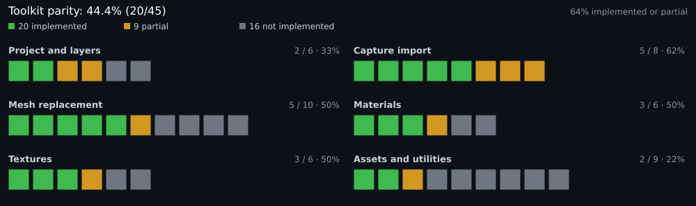

> This project uses AI-generated code.

**English** · [Русский](docs/README.ru.md)

# Remix Toolkit for Blender

Import RTX Remix captures and author replacement meshes, materials and lights back into a Remix mod (`mod.usda`) — in Blender, without RTX Remix Toolkit, Omniverse Kit or a background service.

[**Releases**](https://github.com/hopelessnes5/blender-remix/releases) · [Feature parity](docs/PARITY.md) · [Issues](https://github.com/hopelessnes5/blender-remix/issues)

Not affiliated with NVIDIA. RTX Remix, the RTX Remix Toolkit and AperturePBR materials belong to NVIDIA.

## Status

 

20 of 45 tracked Toolkit features are fully implemented, 9 are partial. Snapshot: 31 October 2026. Tested on Blender 4.5.5 LTS and 5.1.2, 89/89 tests. Full tables and unverified items: [docs/PARITY.md](docs/PARITY.md).

## How it works

- **Direct backend.** NVIDIA's capture algorithms run in-process on Blender's bundled `pxr`/OpenUSD. No Kit, StageCraft, MCP or HTTP/REST service, and no intermediate import files.
- **Read-only captures.** Capture layers are locked; only the mod/active target layer is authored.
- **Instant rollback.** Set `REMIX_IMPORT_BACKEND=legacy` to use the previous importer, or `direct-only` to forbid fallback. Details in [PARITY](docs/PARITY.md#backend-switch-and-rollback).

## Install

Requires Blender 4.0+ on Windows (or Wine on Linux). The release zip bundles `texconv`.

1. Download the [latest release](https://github.com/hopelessnes5/blender-remix/releases).
2. In Blender: `Edit > Preferences > Add-ons > Install...` and pick `rtx_remix_importer.zip`.
3. Enable **Remix Toolkit for Blender**.

For a source install, put `texconv.exe` into `rtx_remix_importer/texconv/` and install the `rtx_remix_importer` folder. If Blender ignores code changes, run `delete-py-cache-and-open-blender.ps1`.

## Usage

1. Open the **RTX Remix** panel in the 3D Viewport sidebar (`N`) and import a capture.
2. Set `RTX Remix Project > Remix Mod File` to an existing `mod.usda` or create one, then choose the target sublayer.
3. Place replacements and press `Export Selected Meshes/Lights` or `Export Selected Materials`.
4. Use `Hide Selected Meshes` / `Restore Hidden Meshes` to mask captured geometry without exporting it.

`Export Settings` controls the target mesh, scale, transforms, texture reuse and output folders. Every write goes to the active target layer.

## Known issues

- Skinned meshes and non-USD sources (FBX/OBJ/glTF) are not supported.
- `Apply Mod File Changes` is experimental.
- Lights exported without a target mesh go to `/RootNode/remix_assets`, not `/RootNode/lights/light_<HASH>`.
- Albedo textures with alpha may not round-trip; some DDS files appear purple — use `Captures > Fix Broken Textures`.
- The Aperture node group is incomplete (animation, iridescence, flags, …).
- Only one reference per mesh prim is supported; assets cannot be combined into one mesh.

## Troubleshooting

| Symptom | Fix |
|---|---|
| Add-on fails to enable after an update | Run `delete-py-cache-and-open-blender.ps1`, restart Blender |
| Textures are not converted to DDS | Put `texconv.exe` into `rtx_remix_importer/texconv/` |
| Purple textures | `Captures > Fix Broken Textures` |
| "No Target Mesh selected" on export | Choose the captured mesh in `Export Settings > Target Mesh` |

## Credits

- Uncle Burrito (RTX Remix Showcase Discord) — Aperture Opaque node group.
- Based on the original *Remix Toolkit for Blender* by sambow23; this fork is maintained by [hopelessnes5](https://github.com/hopelessnes5/).
- Ported NVIDIA code retains its Apache-2.0 attribution headers.

Version 0.4.
