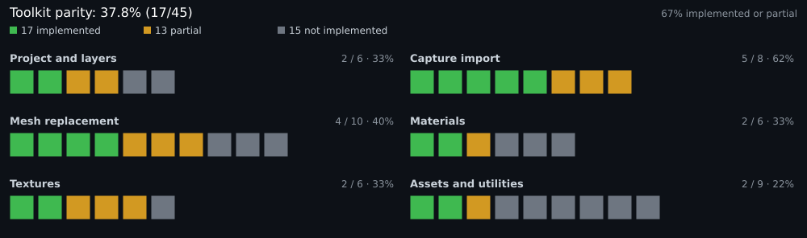

> This project uses AI-generated code.

**English** · [Русский](docs/README.ru.md)

# Remix Toolkit for Blender

Import RTX Remix captures and author replacement meshes, materials and lights back into a Remix mod (`mod.usda`) — in Blender, without RTX Remix Toolkit, Omniverse Kit or a background service.

[**Releases**](https://github.com/hopelessnes5/blender-remix/releases) · [Feature parity](docs/PARITY.md) · [Issues](https://github.com/hopelessnes5/blender-remix/issues)

Not affiliated with NVIDIA. RTX Remix, the RTX Remix Toolkit and AperturePBR materials belong to NVIDIA.

## Status

 

17 of 45 tracked Toolkit features are fully implemented, 13 are partial. Snapshot: 4 November 2026. Tested on Blender 4.5.5 LTS and 5.1.2, 330/330 tests. Full tables and unverified items: [docs/PARITY.md](docs/PARITY.md).

## How it works

- **Direct backend.** NVIDIA's capture algorithms run in-process on Blender's bundled `pxr`/OpenUSD. No Kit, StageCraft, MCP or HTTP/REST service, and no intermediate import files.
- **Read-only captures.** Capture layers are locked; only the mod/active target layer is authored.
- **Capture normals.** As in version 0.4.1, captures use `primvars:normals` when present; otherwise Blender calculates smooth normals.
- **Instant rollback.** Set `REMIX_IMPORT_BACKEND=legacy` to use the previous importer, or `direct-only` to forbid fallback. Details in [PARITY](docs/PARITY.md#backend-switch-and-rollback).

## Install

Requires Blender 4.0+ on Windows (or Wine on Linux). The release zip bundles `texconv`.

1. Download the [latest release](https://github.com/hopelessnes5/blender-remix/releases).
2. In Blender: `Edit > Preferences > Add-ons > Install...` and pick `rtx_remix_importer.zip`.
3. Enable **Remix Toolkit for Blender**.

For a source install, put `texconv.exe` into `rtx_remix_importer/texconv/` and install the `rtx_remix_importer` folder. If Blender ignores code changes, run `delete-py-cache-and-open-blender.ps1`.

## Usage

1. Open the **RTX Remix** panel in the 3D Viewport sidebar (`N`) and import a capture.
2. Set `RTX Remix Project > Remix Mod File` to an existing `mod.usda` or create one, then choose the target sublayer.
3. Place replacements and press `Export Selected Meshes/Lights` or `Export Selected Materials`.
4. Use `Hide Selected Meshes` / `Restore Hidden Meshes` to mask captured geometry without exporting it.

`Export Settings` controls the target mesh, scale, transforms and output folders. Every write goes to the active target layer.

In `Export Settings > Normal Encoding`, choose conversion from OpenGL RGB to octahedral (the default), an already octahedral RG texture, or an OpenGL / DirectX RGB texture. The latter three preserve the source channels while saving a linear DDS. The already encoded option requires octahedral coordinates; a zero blue channel alone does not make a texture octahedral. The selection is saved per Blender scene.

## Known issues

- Skinned meshes and non-USD sources (FBX/OBJ/glTF) are not supported.
- `Apply Mod File Changes` is experimental.
- Lights exported without a target mesh go to `/RootNode/remix_assets`, not `/RootNode/lights/light_<HASH>`.
- Albedo textures with alpha may not round-trip; some DDS files appear purple — use `Captures > Fix Broken Textures`.
- Geometry export splits meshes with multiple materials into separate USD meshes. Direct import of a prototype containing multiple meshes is not yet supported and stops with an error to avoid losing parts; material-only replacement still uses the first slot.
- Materials missing from a capture are handled; legacy Aperture node groups written by old releases render as-is, new materials always build on a standard Principled BSDF.
- Only one reference per mesh prim is supported; assets cannot be combined into one mesh.

For existing mods, the [texture suffix cleanup utility](docs/MOD_CLEANUP.ru.md) offers a dry run and backup before changes.

## Troubleshooting

| Symptom | Fix |
|---|---|
| Add-on fails to enable after an update | Run `delete-py-cache-and-open-blender.ps1`, restart Blender |
| Textures are not converted to DDS | Put `texconv.exe` into `rtx_remix_importer/texconv/` |
| Purple textures | `Captures > Fix Broken Textures` |
| "No Target Mesh selected" on export | Choose the captured mesh in `Export Settings > Target Mesh` |

## Credits

- Based on the original *Remix Toolkit for Blender* by sambow23; this fork is maintained by [hopelessnes5](https://github.com/hopelessnes5/).
- Ported NVIDIA code retains its Apache-2.0 attribution headers.

Version 0.5.

<!-- BEGIN 2026-11-06 PATCH STATUS -->
## Local patch status — 6 November 2026

**Post-snapshot changes, not a verified release.** Local patches cover RG normal-map nodes (Separate Color → Combine Color, B=1 → Normal Map; user confirmed the node works), instance-aware placement and sharing of prototype lights/meshes, `SphereLight` cone-to-SPOT detection, Glass BSDF for genuine `AperturePBR_Translucent`, Principled BSDF for opaque `subsurface_*` materials, and mesh viewport visibility/UV preservation during mod application.

**Confirmed deployment dependency issue:** `mod_apply_utils.py` requires `rtx_remix_importer/material_family.py`. An incremental patch updated its import site but omitted the new module, causing `ModuleNotFoundError` in `Apply Mod File Changes`. The missing file was packaged separately as `Blender_Remix_Missing_Material_Family_Fix.zip`. The classifier's seven standalone unit tests pass; Blender runtime, complete capture+mod workflows, and game output after these patches have **not** been rerun here. Earlier test badges/counts reflect prior snapshots only. The `bl_info` version remains 0.5.0.

See [6 November work status and verification plan](docs/PROGRESS_2026-11-06.ru.md) before packaging a release.
<!-- END 2026-11-06 PATCH STATUS -->

<!-- BEGIN 2026-11-06 SKY-SUN PATCH -->
## 6 November 2026: SKY/SUN import patch (local, unverified in Blender)

`Blender_Remix_Sky_Sun_Import_Fix.zip` addresses `No capture instance for prototype light ...; skipping` when Blender sky geometry is named `sky_<16-hex HASH>` but the mod's light remains under `/RootNode/meshes/mesh_<HASH>`. The Blender object may have no `usd_instance_path`. The patched `mod_loader.py` recognizes sky meshes by strict name/hash matching and materializes `DistantLight` as `SUN` without a capture instance, including lights nested in `ref_*` assets. It aims to preserve the sky mesh and UV layers and avoid duplicate SUN objects on repeated Apply. No independent proof of actual Blender behavior is available.

**Verification:** 8/8 standalone unit tests passed when executed with the existing `light_sharing.py`; the `bpy + pxr` integration test has not been run. Verify both `light_17d87578` and `light_bf922cef`, their directions, SUN type, sky UV/visibility, duplicate prevention, and unchanged USD files. See [the current progress](docs/PROGRESS_2026-11-06.ru.md).
<!-- END 2026-11-06 SKY-SUN PATCH -->
