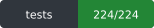
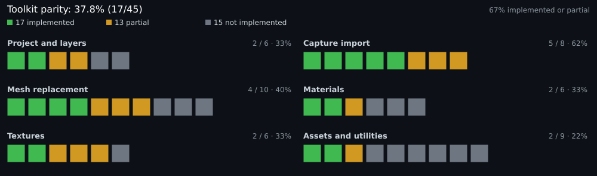

> В этом проекте используется код, сгенерированный ИИ.

[English](../README.md) · **Русский**

# Remix Toolkit для Blender

Импорт захватов RTX Remix и запись заменённой геометрии, материалов и источников света обратно в мод Remix (`mod.usda`) — прямо в Blender, без RTX Remix Toolkit, Omniverse Kit и фоновых сервисов.

[**Релизы**](https://github.com/hopelessnes5/blender-remix/releases) · [Сравнение возможностей](PARITY.ru.md) · [Проблемы](https://github.com/hopelessnes5/blender-remix/issues)

Проект не связан с NVIDIA. RTX Remix, RTX Remix Toolkit и материалы AperturePBR принадлежат NVIDIA.

## Статус

 

17 из 45 отслеживаемых функций Toolkit реализованы полностью, 13 — частично. Снимок: 1 ноября 2026. Проверено на Blender 4.5.5 LTS и 5.1.2: 244/244 тестов. Подробные таблицы и непроверенные пункты: [docs/PARITY.ru.md](PARITY.ru.md).

## Как это работает

- **Прямой backend.** Алгоритмы NVIDIA выполняются в процессе Blender на встроенном `pxr`/OpenUSD. Без Kit, StageCraft, MCP, HTTP/REST-сервисов и промежуточных файлов импорта.
- **Capture только для чтения.** Слои захвата заблокированы; запись идёт только в mod-слой / активный целевой слой.
- **Мгновенный откат.** `REMIX_IMPORT_BACKEND=legacy` возвращает старый импортёр, `direct-only` запрещает fallback. Подробности: [PARITY](PARITY.ru.md#прямой-backend-nvidia-p0).

## Установка

Нужен Blender 4.0+ под Windows (или Wine в Linux). В ZIP релиза уже включён `texconv`.

1. Скачайте [последний релиз](https://github.com/hopelessnes5/blender-remix/releases).
2. В Blender: `Edit > Preferences > Add-ons > Install...` → `rtx_remix_importer.zip`.
3. Включите **Remix Toolkit for Blender**.

При установке из исходников положите `texconv.exe` в `rtx_remix_importer/texconv/` и установите папку `rtx_remix_importer`. Если Blender не видит изменения кода, запустите `delete-py-cache-and-open-blender.ps1`.

## Использование

1. Откройте панель **RTX Remix** на боковой панели 3D Viewport (`N`) и импортируйте захват.
2. Укажите `RTX Remix Project > Remix Mod File` на существующий `mod.usda` или создайте новый, затем выберите целевой подслой.
3. Разместите замены и нажмите `Export Selected Meshes/Lights` или `Export Selected Materials`.
4. `Hide Selected Meshes` / `Restore Hidden Meshes` скрывают захваченную геометрию без экспорта.

`Export Settings` управляет целевой геометрией, масштабом, трансформациями и каталогами вывода. Все записи идут в активный целевой слой.

В `Export Settings > Normal Encoding` можно выбрать преобразование OpenGL RGB в октаэдрическую кодировку (по умолчанию), уже закодированную октаэдрическую текстуру RG или текстуру OpenGL / DirectX RGB. Последние три варианта сохраняют исходные каналы в линейном DDS. Для варианта с готовой октаэдрической текстурой нужны именно октаэдрические координаты: обнулённый синий канал сам по себе не означает такую кодировку. Выбор сохраняется в сцене Blender.

## Известные проблемы

- Скиннинг-геометрия, а также импорт не-USD ресурсов (FBX/OBJ/glTF) не поддерживаются.
- `Apply Mod File Changes` — экспериментальная функция.
- Источники света, экспортированные без целевой геометрии, попадают в `/RootNode/remix_assets`, а не в `/RootNode/lights/light_<HASH>`.
- Альбедо-текстуры с альфа-каналом могут не проходить полный цикл; некоторые `.dds` выглядят фиолетовыми — используйте `Captures > Fix Broken Textures`.
- Материалы, отсутствующие в захвате, обрабатываются; группы узлов Aperture от старых выпусков рендерятся как есть, новые материалы всегда собираются из стандартного Principled BSDF.
- На один mesh prim поддерживается только одна ссылка; объединить ресурсы в одну геометрию нельзя.

Для существующих модов доступен [скрипт очистки суффиксов текстур](MOD_CLEANUP.ru.md) с анализом и резервной копией.

## Устранение неполадок

| Проблема | Решение |
|---|---|
| Дополнение не включается после обновления | Запустите `delete-py-cache-and-open-blender.ps1` и перезапустите Blender |
| Текстуры не преобразуются в DDS | Положите `texconv.exe` в `rtx_remix_importer/texconv/` |
| Фиолетовые текстуры | `Captures > Fix Broken Textures` |
| При экспорте появляется «No Target Mesh selected» | Выберите захваченную геометрию в `Export Settings > Target Mesh` |

## Благодарности

- На основе оригинального *Remix Toolkit for Blender* от sambow23; форк сопровождает [hopelessnes5](https://github.com/hopelessnes5/).
- Порты кода NVIDIA сохраняют заголовки атрибуции Apache-2.0.

Версия 0.4.
